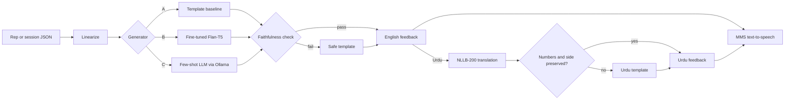

# PhysioCoach-NLP

**Faithful natural-language exercise coaching, in English and Urdu, read or spoken, generated from structured movement analysis.**

An exercise-form classifier outputs numbers like `SHALLOW: 0.91, KNEE_BENT: 0.12`. A patient needs
*"Lift your left leg higher, about 12 degrees short."* PhysioCoach-NLP is the language layer between the two:
a data-to-text system that turns per-rep analysis into short coaching cues and session summaries, and
checks every output so it does not tell a patient to fix something that was not wrong.

```
{"exercise": "side_leg_raise", "side": "left", "faults": {"SHALLOW": 0.91, "KNEE_BENT": 0.12}, ...}
        ↓
EN  Lift your left leg higher, about 12 degrees short. Knee is nice and straight.
UR  اپنی بائیں ٹانگ تھوڑی اور اوپر اٹھائیں، ابھی 12 ڈگری کم ہے۔ گھٹنا بالکل سیدھا ہے، شاباش۔
🔊  spoken in either language
```

## How it works



- **Three generators compared:** a rule-based template baseline, a fine-tuned **Flan-T5**, and a few-shot local **LLM**.
- **Checker-guided sampling:** Flan-T5 samples several candidates and the checker keeps only faithful ones,
  adding variety that beam search lacks without giving up faithfulness.
- **Faithfulness checker:** detects hallucinated corrections, missing faults, praise of present faults, wrong sides,
  and numbers that are unsupported or attached to the wrong fact ("3 sets" when there were 2). Failing outputs are replaced by a template, so every output that reaches a user is faithful.
- **Urdu without Urdu training data:** the checked English is translated with **NLLB-200**, then a preservation
  check confirms every number and left/right side survived; otherwise a hand-written Urdu template is used.
- **Speech:** **MMS-TTS** voices for English and Urdu, with numbers spelled out and audio cached.
- **Live mode:** per-rep cues use hand-written Urdu and sentence-cached audio, so a spoken cue plays in
  milliseconds; machine translation is kept for session summaries.
- **Fast on a laptop CPU:** greedy decoding plus ONNX int8 export brings a cue from about 1 s to about 0.3 s.
- **Two demo pages:** `/compare` shows all generators side by side with wrong sentences highlighted;
  `/live` simulates a full workout with spoken cues and a session summary.
- **Graceful degradation:** with no ML libraries installed, everything still works on templates.

## Quick start

```bash
python -m venv .venv && source .venv/bin/activate     # Windows: .venv\Scripts\Activate.ps1
pip install -e ".[dev]"
pytest                                                # 62 tests
physiocoach demo -n 5 --lang ur
physiocoach serve                                     # web demo at http://127.0.0.1:8000
```

The full step-by-step path (dataset, Colab training, Ollama, Urdu and speech, evaluation, human study) is in
**[docs/BUILD_GUIDE.md](docs/BUILD_GUIDE.md)**.

## Results

> Fill in from `results/metrics.md` after running `scripts/evaluate.py` on the hand-verified test set.

| Generator | BLEU | BERTScore | Faithful (raw) | Hallucination | Latency |
|---|---|---|---|---|---|
| A · Template | | | | | |
| B · Flan-T5-small | | | | | |
| B+ · Flan-T5 + guided sampling | | | | | |
| C · LLM (qwen2.5:3b) | | | | | |

## Project structure

```
src/physiocoach/
  config/exercises.yaml   exercises, faults, EN/UR templates, detection rules (single source of truth)
  schema.py               rep and session record schema (the integration contract)
  records.py              synthetic record generator
  facts.py                what is true about a record (shared by templates and checker)
  templates.py            Method A, the dataset reference generator, and the safe fallback
  faithfulness.py         the checker
  linearize.py            record -> text for seq2seq models
  generators.py           Template, Flan-T5 (PyTorch/ONNX), Ollama LLM backends
  translate.py            NLLB translation + preservation check + glossary + cache
  tts.py                  MMS (and optional Piper) speech + cache
  pipeline.py             generate -> check -> translate -> speak
  api.py, web/            FastAPI service; demo, compare and live-session pages
scripts/                  build_dataset, train_t5, evaluate, export_onnx, benchmark_latency,
                          evaluate_translation, speech_eval, precompute_audio, human_eval
notebooks/                train_on_colab.ipynb
docs/                     BUILD_GUIDE.md, INTEGRATION.md
```

## API

| Endpoint | Purpose |
|---|---|
| `POST /api/feedback/rep` | `{"record": {...}, "lang": "en"\|"ur", "backend": "template"\|"t5"\|"llm", "speak": bool}` |
| `POST /api/feedback/session` | same, with `"session": {"exercise", "side", "reps": [...]}` |
| `GET /api/sample/rep`, `/api/sample/session` | random synthetic records |
| `POST /api/compare` | run several generators on one record, with per-sentence annotations |
| `GET /api/status` | which generators, translator and voice are available |

Interactive docs at `/docs`. Integration with a movement-analysis system is described in
[docs/INTEGRATION.md](docs/INTEGRATION.md).

## Scope and licences

A documentation and coaching assistant: it rewords what the movement analysis found. It does not diagnose,
prescribe or replace a physiotherapist. The dataset is synthetic, so results show feasibility, not clinical
validation. Code: MIT. Model weights used at runtime keep their own licences: NLLB-200 and MMS-TTS are
CC-BY-NC 4.0 (non-commercial); Flan-T5 is Apache 2.0.

Built by Muhammad Mujtaba Khan Suri (UBIT, University of Karachi) as an NLP course project, designed to plug
into the PhysioLens exercise-form analysis system.
