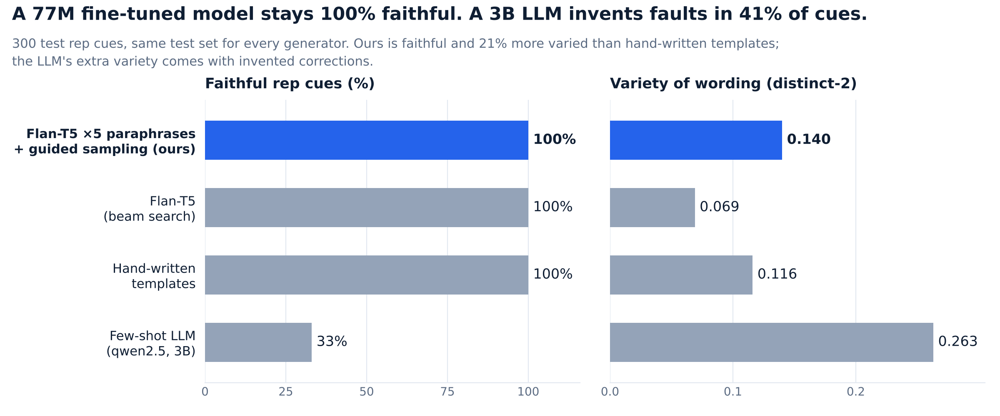
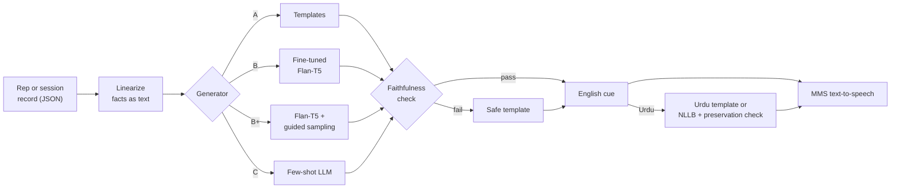

<div align="center">

# PhysioCoach

### Faithful, bilingual exercise coaching from movement analysis

**A 77M-parameter fine-tuned model that stayed 100% faithful where a 3B LLM was right only 33% of the time.**

[](https://www.python.org/)
[](https://huggingface.co/docs/transformers)
[](https://onnxruntime.ai/)
[](https://fastapi.tiangolo.com/)
[](#quick-start)
[](LICENSE)

<!-- DEMO GIF: record ~30 s of the Compare tab (LLM sentence turning red) and the Live session speaking,
     save it as docs/assets/demo.gif, then replace this comment with:

-->



</div>

---

## The problem

An exercise-form model outputs numbers like `SHALLOW: 0.91, KNEE_BENT: 0.12`. A patient needs a sentence:
**"Lift your left leg higher, about 12 degrees short."**

Asking a general LLM to write that sentence is risky. In testing, a 3B model told patients to fix something that
was *fine* in **41%** of cues. In physiotherapy, a wrong correction can cause harm.

PhysioCoach is the language layer between the two: it turns per-rep analysis into short coaching cues and session
summaries, in **English or Urdu**, on screen or **spoken aloud**, and it checks every sentence against the data before
the patient hears it.

```
{"exercise": "side_leg_raise", "side": "left", "faults": {"SHALLOW": 0.91, "KNEE_BENT": 0.12}, ...}
        ↓
EN  Lift your left leg higher, about 12 degrees short. Knee is nice and straight.
UR  اپنی بائیں ٹانگ تھوڑی اور اوپر اٹھائیں، ابھی 12 ڈگری کم ہے۔ گھٹنا بالکل سیدھا ہے، شاباش۔
🔊  spoken in either language
```

## Highlights

- **Faithful by design.** A rule-based checker verifies every fault, number and left/right word in each output, and
  checks each number against the exact fact it describes. Anything unsupported is replaced by a safe template.
- **Fine-tuning beats prompting.** Flan-T5-small (77M) fine-tuned on a purpose-built dataset was **100% faithful**;
  a few-shot 3B LLM was **33%**, and about 10× slower.
- **Checker-guided sampling.** The model samples 6 candidates, the checker removes unfaithful ones, and one is picked
  at random. This **doubled variety (0.069 → 0.140)** with no loss of faithfulness, 21% more varied than hand-written templates.
- **LLM-augmented, checker-filtered data.** An LLM paraphrased 1,200 training cues; the checker rejected **36%** for
  changing the meaning.
- **Urdu + speech.** Urdu via hand-written templates (live) or NLLB-200 translation with a number/side preservation
  check (summaries); MMS-TTS voices in both languages, with sentence-level audio caching.
- **Fast on a laptop CPU.** Greedy decoding + ONNX int8 quantization: **447 → 176 ms per cue (2.5×), 311 → 153 MB**,
  still 100% faithful.
- **One web app, three tabs.** *Demo* (any record → feedback), *Compare* (all generators side by side, wrong sentences
  highlighted in red with the reason) and *Live session* (a simulated workout with spoken cues and a final summary).

## How it works



## Results

**Rep cues**, 300 test records (split by record, same test set for every generator):

| Generator | Faithful | Hallucination | Variety (distinct-2) | BLEU | Time per cue* |
|---|---|---|---|---|---|
| A · Templates | 100% | 0% | 0.116 | 85.6 | < 1 ms |
| B · Flan-T5, templates only (beam) | 100% | 0% | 0.068 | 82.6 | 0.8 s |
| B · Flan-T5, paraphrases ×5 (beam) | 100% | 0% | 0.069 | 82.6 | 0.9 s |
| **B+ · Flan-T5, paraphrases ×5 + guided sampling** | **100%** | **0%** | **0.140** | 81.7 | 2.4 s |
| C · Few-shot LLM (qwen2.5:3b) | 33% | 41% | 0.263 | 16.4 | 8.4 s |

\*PyTorch on a laptop CPU, before optimization. Session summaries: every Flan-T5 variant 100% faithful, the LLM 91%.
BLEU is measured against template-generated references, so it naturally favours templates.

**Speed after optimization** (best model, laptop CPU):

| Setup | Time per cue | Faithful | Size |
|---|---|---|---|
| PyTorch, beam search | 447 ms | 100% | 311 MB |
| PyTorch, greedy | 273 ms | 100% | 311 MB |
| **ONNX int8, greedy** | **176 ms** | **100%** | **153 MB** |

### What we learned

1. **Small and fine-tuned beats big and prompted** for a narrow, safety-critical task.
2. **Beam search hides training-data variety.** Every Flan-T5 variant scored about 0.07 with beam search, whatever it was trained on.
3. **Sampling plus a checker releases that variety safely.**
4. **LLM output, including LLM-made training data, needs a checker:** it caught 67% of LLM cues and 36% of LLM paraphrases.

## Quick start

```bash
git clone https://github.com/MMujtabaX/PhysioCoach.git
cd PhysioCoach
python -m venv .venv && source .venv/bin/activate     # Windows: .venv\Scripts\Activate.ps1
pip install -e ".[dev]"
pytest                                                # 62 tests
physiocoach serve                                     # http://127.0.0.1:8000
```

That runs everything on templates, with no ML libraries needed. To add the trained model, Urdu translation and speech:

```bash
pip install -e ".[ml,onnx]"
python scripts/build_dataset.py --out data            # ~14k input→feedback pairs
# train on a free Colab GPU: notebooks/train_on_colab.ipynb  (~15 min on a T4)
python scripts/export_onnx.py --model models/flan-t5-coach --quantize
PHYSIOCOACH_T5_DIR=models/flan-t5-coach-onnx-int8 physiocoach serve
```

The full path (dataset, training, Ollama comparison, Urdu and speech, evaluation, human study) is in
**[docs/BUILD_GUIDE.md](docs/BUILD_GUIDE.md)**.

## Project structure

```
src/physiocoach/
  config/exercises.yaml   exercises, faults, EN/UR templates, detection rules (single source of truth)
  schema.py, records.py   record schema and synthetic record generator
  facts.py                what is true about a record (shared by templates and checker)
  templates.py            Method A, dataset references, and the safe fallback
  faithfulness.py         the checker, with per-sentence annotation
  generators.py           Template, Flan-T5 (PyTorch/ONNX), guided sampling, Ollama LLM
  translate.py, tts.py    NLLB translation + preservation check; MMS speech + cache
  pipeline.py, api.py     generate → check → translate → speak; FastAPI service
  web/                    single-page app: Demo · Compare · Live session
scripts/                  build_dataset, train_t5, evaluate, export_onnx, benchmark_latency,
                          evaluate_translation, speech_eval, precompute_audio, human_eval
notebooks/                Colab training notebooks
docs/                     BUILD_GUIDE.md, INTEGRATION.md
```

## API

| Endpoint | Purpose |
|---|---|
| `POST /api/feedback/rep` | `{"record": {...}, "lang": "en"\|"ur", "backend": "template"\|"t5"\|"t5-guided"\|"llm", "speak": bool}` |
| `POST /api/feedback/session` | the same, with `"session": {"exercise", "side", "reps": [...]}` |
| `POST /api/compare` | run several generators on one record, with per-sentence annotations |
| `GET /api/status` | which generators, translator and voice are available |

Interactive docs at `/docs`. To plug in a movement-analysis system, see [docs/INTEGRATION.md](docs/INTEGRATION.md).

## Limitations

- Trained and evaluated on **synthetic** records: the results show the method works, not clinical validity.
- The checker is rule-based, so unusual phrasings can be missed or wrongly rejected; real LLM failures are kept as regression tests.
- Live Urdu uses hand-written templates, so it has less variety than English.
- A coaching aid only: it rewords what the movement analysis found and does not diagnose or prescribe.

## Credits and licences

Built by **[Muhammad Mujtaba Khan Suri](https://www.linkedin.com/in/muhammad-mujtaba-khan-suri)** (UBIT, University of
Karachi) as an NLP course project, designed to plug into the PhysioLens exercise-form analysis system.

Code: MIT. Models used at runtime keep their own licences: Flan-T5 (Apache 2.0); NLLB-200 and MMS-TTS (CC-BY-NC 4.0,
non-commercial).
